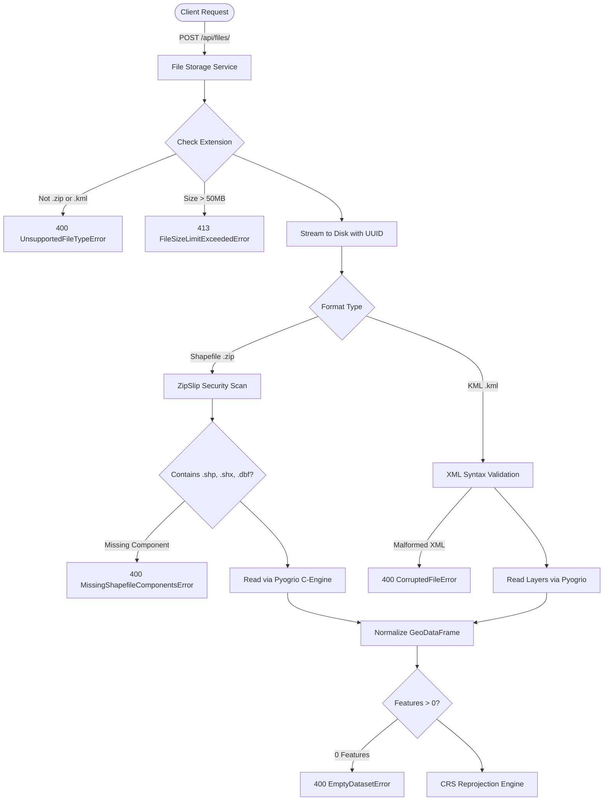
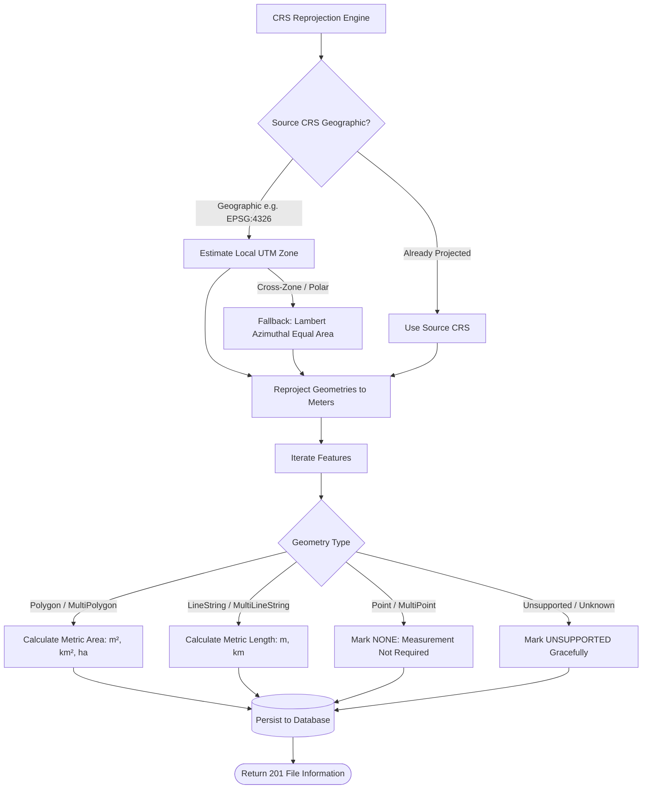

# Geospatial File Measurement API

A production-ready, high-performance REST API built with **FastAPI**, **GeoPandas**, **Pyogrio**, **Shapely**, and **Pyproj**. The service accepts geospatial files (ESRI Shapefile `.zip` archives and `.kml` files), dynamically reprojects geographic coordinates to optimal projected Coordinate Reference Systems (CRS), calculates metric area and length measurements, and handles all edge cases and exceptions gracefully.

---

## Table of Contents

- [Features](#features)
- [Architecture & Data Flow](#architecture--data-flow)
  - [Application Structure](#application-structure)
  - [File Processing Flow](#file-processing-flow)
  - [Measurement Calculation Flow](#measurement-calculation-flow)
  - [CRS Handling Strategy](#crs-handling-strategy)
- [Design Decisions & Alternatives](#design-decisions--alternatives)
- [Setup & Running Locally](#setup--running-locally)
  - [Prerequisites](#prerequisites)
  - [Option A: Running Locally with `uv`](#option-a-running-locally-with-uv)
  - [Option B: Running with Docker & Docker Compose](#option-b-running-with-docker--docker-compose)
- [API Documentation](#api-documentation)
  - [Interactive OpenAPI Docs](#interactive-openapi-docs)
  - [Endpoints & Examples](#endpoints--examples)
- [Error Handling & Edge Cases](#error-handling--edge-cases)
- [Testing](#testing)
- [Learnings & Future Scope](#learnings--future-scope)

---

## Features

- **Multi-Format Ingestion**: Ingests zipped Shapefiles (`.zip` containing `.shp`, `.shx`, `.dbf`, `.prj`) and `.kml` (including multi-layer KML).
- **Accurate Metric Calculations**:
  - **Polygons / MultiPolygons**: Area in square meters ($m^2$), square kilometers ($km^2$), and hectares ($ha$).
  - **LineStrings / MultiLineStrings**: Length in meters ($m$) and kilometers ($km$).
  - **Points / MultiPoints**: Gracefully skipped without measurement calculations.
  - **Unsupported Geometries**: Identified and reported gracefully without server crashes.
- **Dynamic Projected CRS Resolution**: Automatically detects geographic coordinates (e.g. `EPSG:4326` degrees) and projects geometries to local UTM zones or Lambert Azimuthal Equal Area (LAEA) before computing measurements.
- **Production-Grade Exception Handling**: Custom domain exceptions mapped to standard structured JSON responses (ZipSlip defense, missing shapefile members, malformed XML, invalid geometries).
- **Interactive API Documentation**: Auto-generated Swagger UI (`/docs`) and ReDoc (`/redoc`).
- **Containerized & Test Covered**: Multi-stage `Dockerfile`, `docker-compose.yml`, and a 100% passing `pytest` suite.

---

## Architecture & Data Flow

### Application Structure

The project follows clean layered architecture separating API transport, business domain services, database persistence, and external geospatial libraries:

```
GeoSpatialFile/
├── app/
│   ├── api/
│   │   ├── deps.py                 # Dependency injection (DB session, 404 lookups)
│   │   └── v1/
│   │       ├── router.py           # V1 route aggregator
│   │       └── endpoints/
│   │           ├── files.py        # File upload, retrieval, features, listing, delete
│   │           ├── measurements.py # File measurements & dataset summaries
│   │           └── health.py       # Health check & GDAL driver verification
│   ├── core/
│   │   ├── exceptions.py           # Domain exception hierarchy
│   │   ├── handlers.py             # Global FastAPI exception handlers
│   │   └── logging.py              # Structured logging configuration
│   ├── db/
│   │   ├── base.py                 # SQLAlchemy declarative base
│   │   └── session.py              # Engine, connection pooling, SQLite WAL pragma
│   ├── models/
│   │   └── file_record.py          # FileRecord & FeatureRecord ORM models
│   ├── schemas/
│   │   ├── common.py               # ErrorResponse, Pagination models
│   │   ├── file.py                 # FileInformationResponse, FileListResponse
│   │   └── measurement.py          # MeasurementItemResponse, Summary models
│   ├── services/
│   │   ├── file_storage.py         # Stream saving, size limits, ZipSlip security
│   │   ├── shapefile_parser.py     # Shapefile validation & reading
│   │   ├── kml_parser.py           # KML XML validation & multi-layer parsing
│   │   ├── crs_transformer.py      # CRS detection, UTM & LAEA reprojection
│   │   ├── measurement.py          # Area/Length metric computation
│   │   └── processor.py            # End-to-end ingestion orchestrator
│   ├── config.py                   # Pydantic BaseSettings environment configuration
│   └── main.py                     # FastAPI application factory & lifespan
├── samples/                        # Sample KML and Shapefile test data
├── scripts/
│   └── generate_sample_data.py     # Script to generate sample files
├── tests/                          # 22 automated test suites (pytest)
├── Dockerfile                      # Multi-stage production container
├── docker-compose.yml              # Single-command deployment config
├── pyproject.toml                  # Project dependencies and tool settings
└── uv.lock                         # Deterministic package lockfile
```

### File Processing Flow



### Measurement Calculation Flow



### CRS Handling Strategy

Geographic coordinates (latitude and longitude in degrees, such as `EPSG:4326`) cannot be directly used for planar area or length calculation because the distance of one degree of longitude shrinks towards the poles ($\Delta x = \Delta \lambda \cdot R \cos \phi$). Direct calculation in degrees produces values in "square degrees", which have no uniform physical meaning.

To solve this:
1. **Source Detection**: If the uploaded file lacks CRS metadata, the system assigns standard `EPSG:4326` with a logged notice.
2. **Local UTM Selection**: For geographic datasets, the system calculates the geometric centroid and assigns the corresponding **Universal Transverse Mercator (UTM)** zone (e.g. `EPSG:32643` for UTM Zone 43N). UTM provides high conformal and distance precision within its 6-degree longitudinal zone.
3. **Equal-Area Fallback (LAEA)**: If features cross multiple UTM zones or polar bounds where UTM introduces high scale distortion, the engine falls back to a **Lambert Azimuthal Equal Area (LAEA)** projection centered at the dataset centroid (`+proj=laea +lat_0=... +lon_0=... +datum=WGS84 +units=m`).
4. **Transparent Metadata**: Every measurement response explicitly includes the `source_crs`, `projected_crs`, primary measurement value, and standardized units (`square_meters`, `meters`).

---

## Design Decisions & Alternatives

| Decision | Selected Choice | Considered Alternative | Rationale |
| :--- | :--- | :--- | :--- |
| **Backend Framework** | **FastAPI** | Django + DRF | FastAPI offers native asynchronous I/O, Pydantic v2 type safety, auto-generated OpenAPI documentation, and minimal deployment overhead compared to Django's monolithic ORM/admin stack. |
| **Package Toolchain** | **uv** | Poetry / Pipenv | `uv` is extremely fast (10-100x faster than pip), deterministic, uses standard PEP 621 `pyproject.toml`, and manages virtual environments seamlessly. |
| **I/O Engine** | **Pyogrio** | Pure Fiona / GDAL CLI | Pyogrio provides vectorized C bindings to GDAL with precompiled wheels that include both `KML` and `ESRI Shapefile` drivers, avoiding complex external system library compilations. |
| **Database** | **SQLite + SQLAlchemy 2.0 (WAL mode)** | PostgreSQL / PostGIS | Zero-configuration local startup without external database containers. Clean repository and SQLAlchemy model separation allows switching to PostgreSQL by simply updating `DATABASE_URL`. |
| **Projection Strategy** | **Dynamic UTM / Centroid LAEA** | Web Mercator (EPSG:3857) | EPSG:3857 severely distorts area away from the equator (Greenland appears larger than Africa). Local UTM and LAEA preserve true physical ground dimensions. |
| **Streaming Uploads** | **Chunked Chunk Reading (1MB)** | In-memory read (`file.read()`) | Streaming in 1MB chunks prevents memory exhaustion (OOM crashes) when processing large geospatial files up to the 50MB limit. |

---

## Setup & Running Locally

### Prerequisites

- Python 3.11+ (Python 3.12 recommended)
- [`uv`](https://docs.astral.sh/uv/) (installed via `brew install uv` or `curl -LsSf https://astral.sh/uv/install.sh`)
- *Or* Docker & Docker Compose

### Option A: Running Locally with `uv`

1. **Clone the repository**:
   ```bash
   git clone <repo-url>
   cd GeoSpatialFile
   ```

2. **Sync dependencies and initialize virtual environment**:
   ```bash
   uv sync
   ```

3. **Generate sample datasets (optional)**:
   ```bash
   uv run python scripts/generate_sample_data.py
   ```

4. **Start the API server**:
   ```bash
   uv run uvicorn app.main:app --host 0.0.0.0 --port 8000 --reload
   ```

5. **Access the application**:
   - Interactive Swagger UI: [http://localhost:8000/docs](http://localhost:8000/docs)
   - ReDoc UI: [http://localhost:8000/redoc](http://localhost:8000/redoc)
   - Health check: [http://localhost:8000/health](http://localhost:8000/health)

---

### Option B: Running with Docker & Docker Compose

1. **Build and start the container**:
   ```bash
   docker compose up --build
   ```

2. The service is now live at `http://localhost:8000`.

---

## API Documentation

### Interactive OpenAPI Docs

Navigate to `http://localhost:8000/docs` to test endpoints directly in your browser.

---

### Endpoints & Examples

#### 1. Upload Geospatial File
- **Endpoint**: `POST /api/files/`
- **Content-Type**: `multipart/form-data`
- **Supported Formats**: `.kml` or `.zip` (Shapefile)

**Example Request:**
```bash
curl -X POST "http://localhost:8000/api/files/" \
  -F "file=@samples/sample_survey.kml"
```

**Example Response (201 Created):**
```json
{
  "id": "73d7075d-e3e7-4e75-9475-0addcc84c241",
  "filename": "sample_survey.kml",
  "feature_count": 3,
  "crs": "EPSG:4326",
  "status": "COMPLETED",
  "file_type": "KML",
  "file_size_bytes": 1184,
  "created_at": "2026-10-07T18:18:43.860126Z",
  "error_message": null
}
```

---

#### 2. Get File Information
- **Endpoint**: `GET /api/files/{id}/`

**Example Request:**
```bash
curl -X GET "http://localhost:8000/api/files/73d7075d-e3e7-4e75-9475-0addcc84c241/"
```

**Example Response (200 OK):**
```json
{
  "id": "73d7075d-e3e7-4e75-9475-0addcc84c241",
  "filename": "sample_survey.kml",
  "feature_count": 3,
  "crs": "EPSG:4326",
  "status": "COMPLETED"
}
```

---

#### 3. Get File Measurements
- **Endpoint**: `GET /api/files/{id}/measurements/`
- **Query Parameters**: `limit` (default 100), `offset` (default 0)

**Example Request:**
```bash
curl -X GET "http://localhost:8000/api/files/73d7075d-e3e7-4e75-9475-0addcc84c241/measurements/"
```

**Example Response (200 OK):**
```json
{
  "file_id": "73d7075d-e3e7-4e75-9475-0addcc84c241",
  "filename": "sample_survey.kml",
  "source_crs": "EPSG:4326",
  "summary": {
    "total_features": 3,
    "polygons_measured": 1,
    "lines_measured": 1,
    "points_skipped": 1,
    "unsupported_geometries": 0,
    "total_area_sq_meters": 360503.3768,
    "total_area_sq_km": 0.360503,
    "total_area_hectares": 36.0503,
    "total_length_meters": 1628.3857,
    "total_length_km": 1.628386
  },
  "measurements": [
    {
      "feature_index": 0,
      "feature_identifier": "Cubbon Park Boundary",
      "geometry_type": "Polygon",
      "measurement_type": "AREA",
      "value": 360503.3768,
      "units": "square_meters",
      "additional_metrics": {
        "area_sq_km": 0.360503,
        "area_hectares": 36.0503
      },
      "projected_crs": "EPSG:32643",
      "notes": "Area computed via metric projected CRS",
      "properties": {
        "description": "Heritage park located in the heart of Bengaluru"
      }
    },
    {
      "feature_index": 1,
      "feature_identifier": "MG Road Transit Corridor",
      "geometry_type": "LineString",
      "measurement_type": "LENGTH",
      "value": 1628.3857,
      "units": "meters",
      "additional_metrics": {
        "length_km": 1.628386
      },
      "projected_crs": "EPSG:32643",
      "notes": "Length computed via metric projected CRS",
      "properties": {
        "description": "Major transit road in Central Bengaluru"
      }
    },
    {
      "feature_index": 2,
      "feature_identifier": "Vidhana Soudha Landmark",
      "geometry_type": "Point",
      "measurement_type": "NONE",
      "value": null,
      "units": "none",
      "additional_metrics": {},
      "projected_crs": "EPSG:32643",
      "notes": "Point geometry: no measurement required",
      "properties": {
        "description": "State legislative building"
      }
    }
  ],
  "total": 3,
  "limit": 100,
  "offset": 0
}
```

---

#### 4. List Uploaded Files
- **Endpoint**: `GET /api/files/`
- **Query Parameters**: `status` (`COMPLETED`, `FAILED`), `limit`, `offset`

---

#### 5. Get Feature Geometries (GeoJSON)
- **Endpoint**: `GET /api/files/{id}/features/`

Returns full GeoJSON representations with original coordinate geometry and attribute properties.

---

#### 6. Delete File
- **Endpoint**: `DELETE /api/files/{id}/`
- Deletes the database records and purges the stored file from disk.

---

#### 7. Service Health Check
- **Endpoint**: `GET /health`

```json
{
  "status": "healthy",
  "service": "Geospatial File Measurement API",
  "version": "1.0.0",
  "supported_drivers": ["KML", "LIBKML", "ESRI Shapefile"],
  "timestamp": "2026-10-07T18:18:43.855634+00:00"
}
```

---

## Error Handling & Edge Cases

The API implements a robust exception architecture with standard structured error bodies:

```json
{
  "error": {
    "code": "MISSING_SHAPEFILE_COMPONENTS",
    "message": "The uploaded zip archive must contain .shp, .shx, and .dbf files. Missing components: ['.dbf']",
    "details": {
      "missing": [".dbf"],
      "found": [".shp", ".shx"],
      "required": [".dbf", ".shp", ".shx"]
    }
  }
}
```

| Scenario | HTTP Status | Error Code | Behavior |
| :--- | :--- | :--- | :--- |
| **Unsupported file type** (e.g. `.pdf`, `.docx`) | `400 Bad Request` | `UNSUPPORTED_FILE_TYPE` | Rejected with clear allowed format guidance. |
| **Corrupted zip archive** | `400 Bad Request` | `CORRUPTED_FILE` | Archive integrity verified before unpacking. |
| **Missing Shapefile member** | `400 Bad Request` | `MISSING_SHAPEFILE_COMPONENTS` | Reports exact missing files (`.shp`, `.shx`, `.dbf`). |
| **ZipSlip path traversal attempt** | `400 Bad Request` | `ZIP_SLIP_ATTEMPT` | Path traversal entries (`..`) blocked immediately. |
| **Malformed XML in KML** | `400 Bad Request` | `CORRUPTED_FILE` | XML syntax validated before layer loading. |
| **Empty dataset** (0 features) | `400 Bad Request` | `EMPTY_DATASET` | Clean 400 error instead of silent null. |
| **File not found** | `404 Not Found` | `FILE_NOT_FOUND` | Standard 404 response. |
| **File exceeds size limit** | `413 Payload Too Large` | `FILE_SIZE_LIMIT_EXCEEDED` | Stream aborted; temp file deleted. |
| **Invalid geometry topology** | `200 OK` (Handled) | N/A | Repaired automatically via `shapely.make_valid()`. |

---

## Testing

The application includes an extensive automated test suite covering units, CRS projections, parser drivers, error conditions, and API endpoints.

To run the test suite:

```bash
uv run pytest -v
```

**Results:**
```
======================== 22 passed in 0.56s =========================
```

---

## Learnings & Future Scope

### Learnings
1. **Coordinate System Realities**: Working with real-world geospatial files quickly demonstrates that spatial calculations without proper reprojection produce misleading numbers. Selecting a local UTM zone or equal-area projection based on dataset centroids is critical for high-fidelity physical measurements.
2. **ESRI Shapefile Structural Constraints**: Shapefiles strictly enforce a single geometry type per shapefile layer (e.g. only Polygons or only LineStrings). Handling mixed geometries required distinguishing between Shapefile layer constraints and KML multi-geometry documents.
3. **C-Extensions and Portable Packaging**: Packaging GDAL and GEOS often causes build headaches in Docker and local environments. Using `pyogrio` with wheels bundled with GEOS/GDAL provides reliable, native performance across macOS (Apple Silicon ARM64) and Linux containers.

### Future Scope
- **Asynchronous Task Queue (Celery / ARQ + Redis)**: For datasets containing tens of thousands of features or gigabyte-sized archives, file processing can be delegated to background workers with a polling/webhook status mechanism (`PENDING` -> `PROCESSING` -> `COMPLETED`).
- **PostGIS Storage Integration**: Transitioning the SQLite storage layer to a PostgreSQL + PostGIS database to leverage spatial indexing (`GIST`) and native spatial queries (`ST_Area`, `ST_Length`).
- **Raster and GeoTIFF Support**: Expand file ingestion to support digital elevation models (DEM) and satellite raster imagery for volume and elevation profiling.
- **Export Formats**: Add endpoints to export processed and measured layers directly into GeoJSON, GeoPackage (`.gpkg`), or FlatGeobuf formats.
